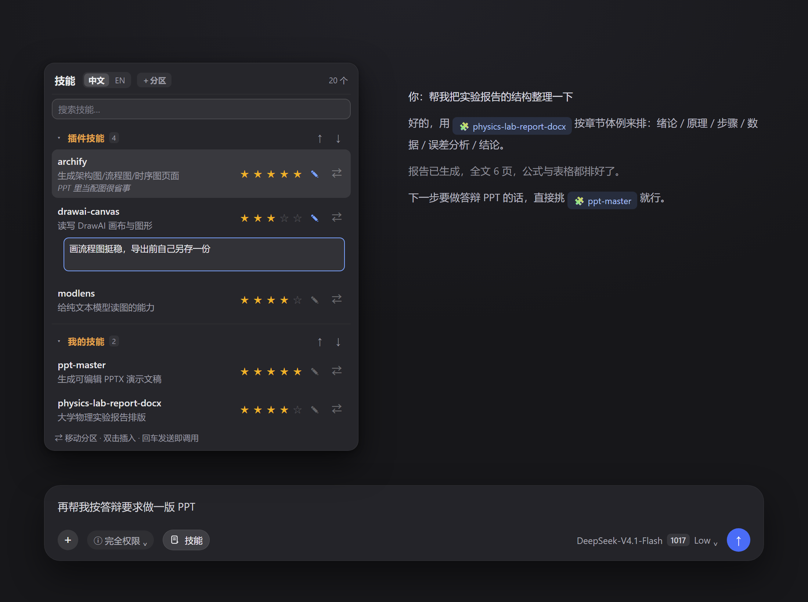
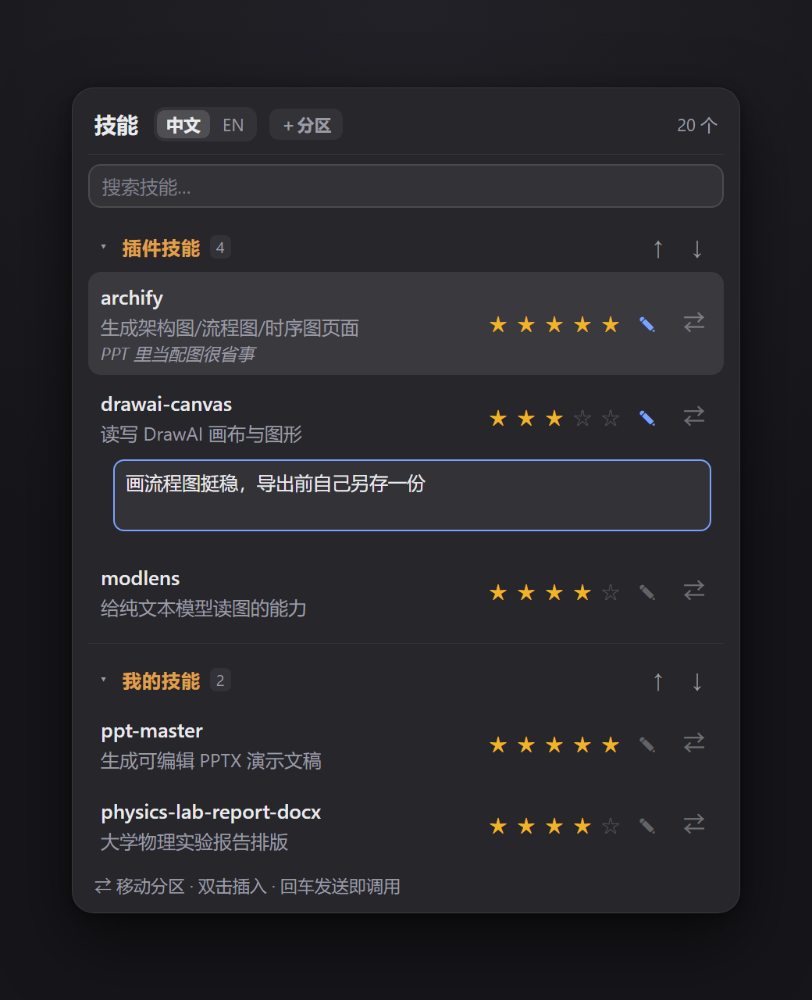

# dsh-skill-picker · DeepSeek Harness 的「技能」抽屉

在对话输入框左下角加一个 **技能** 按钮：点开就能看到当前 Harness 里所有 skill，每个一行 20 字以内的简介，按来源分好区，还能打星、写备注；看到想用的，双击插进输入框，回车就调用。



## 为什么

Skill 是能一直加的：office 全家桶、PPT、画图、浏览器自动化、自己写的工作流……装到十几个之后，日常就变成：

- 想用的时候**想不起名字**（`office-pptx`？`ppt-master`？还是 `chinese-ppt-deck`？）
- 记得名字，也**不确定它到底干什么**，得去翻 `SKILL.md`
- 用过一次觉得"还行"的技能，过两天**忘了是哪个**

Harness 自带的 `/` 触发能搜，但你得先知道搜什么，也记不住"这个技能我上次给过五星"。

## 功能

- **全部技能一目了然**：名字保持原样，下面一行 20 字简介（中文版按每个技能的实际行为写，可切 EN 看原始描述）
- **按来源自动分区**：内置 / 插件 / 我的技能 / 其他；可以自建分区（"演示文稿""实验报告"）、把技能 `⇄` 挪进任意分区、用 ↑↓ 调分区顺序
- **搜索 + 键盘操作**：输入即筛，↑↓ 选，双击插入，回车发送，全程不碰鼠标
- **星级 + 备注**：5 星评分，一句话记录"哪儿好用、什么情况下别用"，数据留在本地
- **插入即文本**：只往输入框写 `/技能名`，不会替你发消息



## 安装

插件是纯 JS 的 Cordis 插件包，没有依赖、没有构建步骤。

### 方式一：把地址丢给 Agent，让它自己装（推荐）

在 DeepSeek Harness 里新建一条消息，把下面这段粘进去：

```
请帮我安装这个 DeepSeek Harness 插件：
https://github.com/Qyn101/QYN.1

1. 把仓库 clone 或下载 ZIP 解压到任意位置。它是纯 JS 的 Cordis bundle：零依赖、没有构建步骤，
   不需要 npm install。
2. 用 plugin_manager → install_bundle 安装，target 填含 package.json 的那一层（不是它的上级目录）。
3. 如果返回 restart-required，请停下来告诉我：需要重启 DeepSeek Harness。
4. 重启后请自查：cordis_inspect_query（client / Slots / listSubTree，root=conversation.input.left）
   里有 id=dsh-skill-picker 的 occupant 且 active=true 就算成功；不在就把报错原文贴给我，不要猜。
5. 卸载用 remove_bundle @local/dsh-skill-picker。

只有我能做的操作（登录、重启）请停下来告诉我。
```

Agent 会自己 clone、调用 `plugin_manager → install_bundle`、提示你重启 Harness，重启后还会用 `cordis_inspect_query` 自查 slot 有没有挂上（而不是靠"看截图"——它看不到你的窗口）。中途要登录 GitHub、要重启这类事，它会停下来告诉你。

### 方式二：手动装

```bash
git clone https://github.com/Qyn101/QYN.1.git
```

1. 克隆到任意目录（路径别带特殊字符）
2. 在 Harness 里安装：`plugin_manager → install_bundle → target = <克隆出来的目录>`（含 `package.json` 的那一层，不是它的上级）
3. 重启一次 DeepSeek Harness（bundle 的插件树是启动时组装的）
4. 之后它以 `link:` 方式挂进 profile：改 `client.js` 只需在窗口里按 **Ctrl+R**，不用重装

没有 git 也行：把仓库打包下来的整个目录拷到目标机器任意位置，让 `install_bundle` 指向它即可。

**卸载**：`plugin_manager → remove_bundle → @local/dsh-skill-picker`，再重启。评分/分区数据在浏览器 `localStorage` 里，卸插件不会带走，重装后还在。


## 用法

1. 点输入框左下角的 **技能**（`＋` 和「完全权限」之间）
2. 搜索或上下键挑一个，**双击**把它插进输入框（插入的是 `/技能名 `）
3. 需要的话补一句你的要求，回车发送

面板里还能：点标题栏 `＋分区` 新建分类、点 ✎ 改分区名、点 `⇄` 把技能换个区、点星星评分、点 ✎ 写备注。

## 数据存在哪

都是本机浏览器 `localStorage`，不上传、不联网：

| 数据 | key |
| --- | --- |
| 分区、技能归属 | `dsh-skill-picker.sections` / `dsh-skill-picker.assign` |
| 分区顺序 | `dsh-skill-picker.order` |
| 星级与备注 | `dsh-skill-picker.ratings` |
| 中 / 英偏好 | `dsh-skill-picker.lang` |

想清空就删这几个 key，或者直接删分区。

## 工作原理

- **Host 半边**（`index.js`）：注册 RPC 通道 `/dsh-skill-picker`，`list` 端点优先用 `sessionSkillCatalog.list({ sessionId })` 取当前会话的技能目录，取不到时退回 `skills.list({})`，返回 `{ name, description, whenToUse?, modelInvocable }`。
- **Client 半边**（`client.js`）：挂两个 slot —— `conversation.input.left` 放按钮，`conversation.input.overlay` 放弹窗（`createPortal` 到 body，靠边缘自动翻转）；列表优先走 `ctx.remote.skills`，失败再走上面那个 RPC 通道。
- **"调用"= 插入文本**：把 `/技能名 ` 写进草稿（`inputActions.captureInsertion()` + `insertText()`，退化到 `setDraft()`）。Harness 自己会把这个 token 认成技能引用，发送时变成 `<skill>名字</skill>` —— 和手打斜杠命令完全等价。

## 兼容性 / 注意

- 依赖 Harness 的 slot 体系：`conversation.input.left` 与 `conversation.input.overlay`。版本变了要是按钮不出现，先确认插件没被禁用。
- 插件**只插入文本**，不直接发消息、不修改会话内容 —— 发不发、发什么，还是你自己按回车决定。
- `images/` 里的图是按插件真实样式和真实数据渲染的界面示意图（原窗口截图受系统捕获保护），布局配色与实机一致，按钮位置以实机为准。

## License

MIT © 2026 Qyn101 —— 见 [LICENSE](LICENSE)。修改、分发、商用都行，保留版权声明即可。
